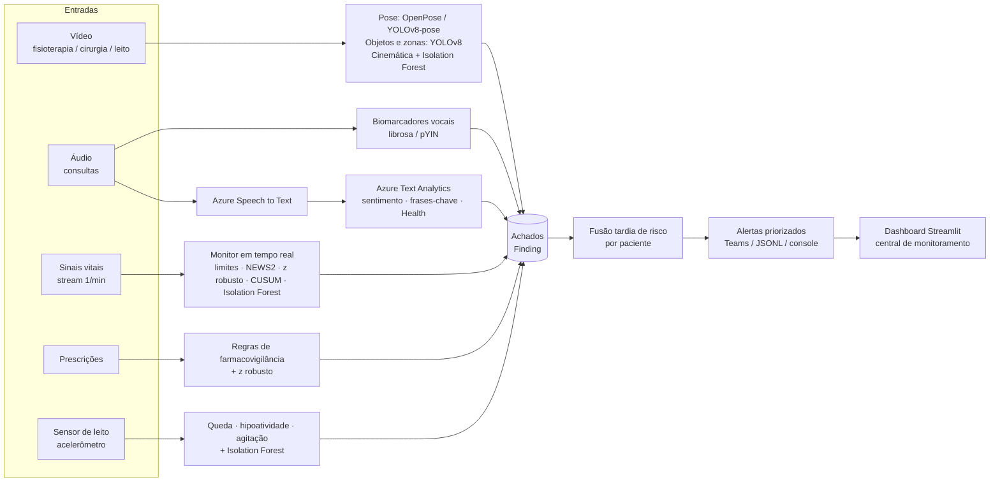
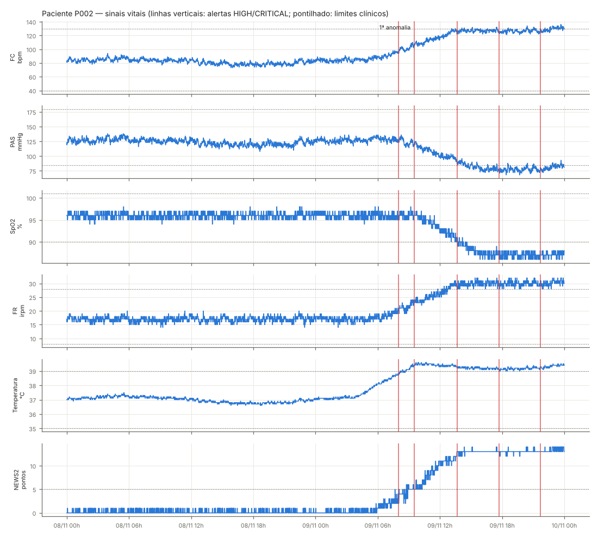

# MedMonitor — Monitoramento multimodal de pacientes com detecção de anomalias

**Tech Challenge · Fase 4 · IA para Devs (POSTECH)**

Sistema que monitora pacientes internados a partir de **vídeo, áudio, texto e sinais clínicos**, detecta
sinais precoces de risco e envia **alertas priorizados** à equipe médica, integrando os serviços gerenciados
do **Azure AI (Speech to Text e Language / Text Analytics)**.



## Resultado da demonstração

Três pacientes sintéticos com anomalias conhecidas (ground truth), processados ponta a ponta em ~45 s em CPU:

| Paciente | Perfil | Risco final | Principais achados |
|---|---|---|---|
| P001 | pós-operatório estável (controle) | **0.00 · INFO** | nenhum — artefato isolado de SpO2 corretamente filtrado |
| P002 | pneumonia com deterioração séptica | **1.00 · CRITICAL** | tendência febril/taquicardia (CUSUM ~3 h antes dos limites clínicos), NEWS2 13, enoxaparina 10× (erro decimal), fala com dispneia e termos críticos, letargia + agitação noturna |
| P003 | reabilitação pós-AVC | **1.00 · CRITICAL** | queda na fisioterapia (vídeo) + queda no sensor de leito, ROM esquerda 104°, assimetria 67°, tremor 5 Hz, disartria na voz, crise hipertensiva, bradicardia, insulina acima do limite |

**16/16 eventos do ground truth classificados corretamente** (incluindo os 3 casos negativos), 11 alertas
consolidados (em vez de 340+ achados brutos). Detalhes em [`docs/RELATORIO_TECNICO.md`](docs/RELATORIO_TECNICO.md).



## Estrutura

```
├── medmonitor/               # pacote principal
│   ├── video/                # pose.py (OpenPose/YOLOv8-pose), detector.py (YOLOv8), movement.py, report.py
│   ├── audio/                # features.py (biomarcadores), azure_speech.py, azure_text.py
│   ├── anomaly/              # vitals.py (tempo real), prescriptions.py, mobility.py
│   ├── synthetic/            # geradores de dados com anomalias injetadas (ground truth)
│   ├── fusion.py             # fusão tardia + escalonamento + ações recomendadas
│   ├── alerts.py             # despacho: console, JSONL (auditoria), webhook Teams (Adaptive Card)
│   ├── pipeline.py           # orquestrador ponta a ponta
│   └── cli.py                # linha de comando
├── dashboard/app.py          # central de monitoramento (Streamlit)
├── scripts/                  # generate_data.py, download_physionet.py
├── config/settings.yaml      # limiares clínicos e parâmetros dos modelos
├── tests/                    # pytest (11 testes)
├── docs/                     # relatório técnico, roteiro do vídeo, setup do Azure
├── data/                     # dados de demonstração (gerados)
└── outputs/                  # resultados da última execução (relatórios, gráficos, vídeos anotados, alertas)
```

## Como executar

Requisitos: Python 3.10+, `ffmpeg` (opcional, para vídeos H.264) e `espeak-ng` (só para regenerar os áudios).

```bash
python -m venv .venv && source .venv/bin/activate      # Windows: .venv\Scripts\activate
pip install -r requirements.txt

python scripts/generate_data.py          # (opcional) regenera os dados sintéticos em data/
python -m medmonitor.cli run-all         # fluxo multimodal completo → outputs/
streamlit run dashboard/app.py           # central de monitoramento
pytest -q                                # testes
```

Outros comandos:

```bash
# Simulação de monitoramento em tempo real (1 h clínica por segundo)
python -m medmonitor.cli stream --speed 3600

# Analisar um áudio próprio (WAV) — usa Azure se houver chaves no .env
python -m medmonitor.cli audio minha_consulta.wav --patient P010

# Analisar um vídeo real de fisioterapia com YOLOv8-pose (com sessão de referência normal)
python -m medmonitor.cli video sessao.mp4 --patient P010 --backend yolov8 --reference sessao_normal.mp4

# Usar a saída do OpenPose (openpose.bin --video x.mp4 --write_json pasta/)
python -m medmonitor.cli video x.mp4 --backend openpose_json --json-dir pasta/

# Dados reais do PhysioNet (BIDMC) + monitor de anomalias
python scripts/download_physionet.py --records 10 --run
```

## Azure

Copie `.env.example` para `.env` e preencha `AZURE_SPEECH_KEY/REGION` e `AZURE_LANGUAGE_KEY/ENDPOINT`
(passo a passo em [`docs/AZURE_SETUP.md`](docs/AZURE_SETUP.md)). Com as chaves, a transcrição usa
**Azure Speech to Text** (pt-BR, reconhecimento contínuo) e o texto passa por **Azure Text Analytics**
(sentimento com opinion mining, frases-chave e **Text Analytics for Health**). Sem chaves, o sistema
funciona em **modo offline** (transcrição de referência / faster-whisper e léxico clínico em português),
com a mesma interface — o dashboard mostra qual motor foi usado. Alertas HIGH/CRITICAL são enviados como
Adaptive Card para um **Incoming Webhook do Microsoft Teams** (ou Logic App) definido em `ALERT_WEBHOOK_URL`.

## Documentação

- [Relatório técnico](docs/RELATORIO_TECNICO.md) — fluxo multimodal, modelos por tipo de dado, resultados e exemplos de anomalias
- [Roteiro do vídeo de demonstração (≤ 15 min)](docs/ROTEIRO_VIDEO.md)
- [Configuração do Azure](docs/AZURE_SETUP.md)
- [Resultados da última execução](outputs/RESULTADOS.md)

> Projeto acadêmico. Os dados de demonstração são sintéticos e os limiares são didáticos —
> não utilizar para decisões clínicas reais.
