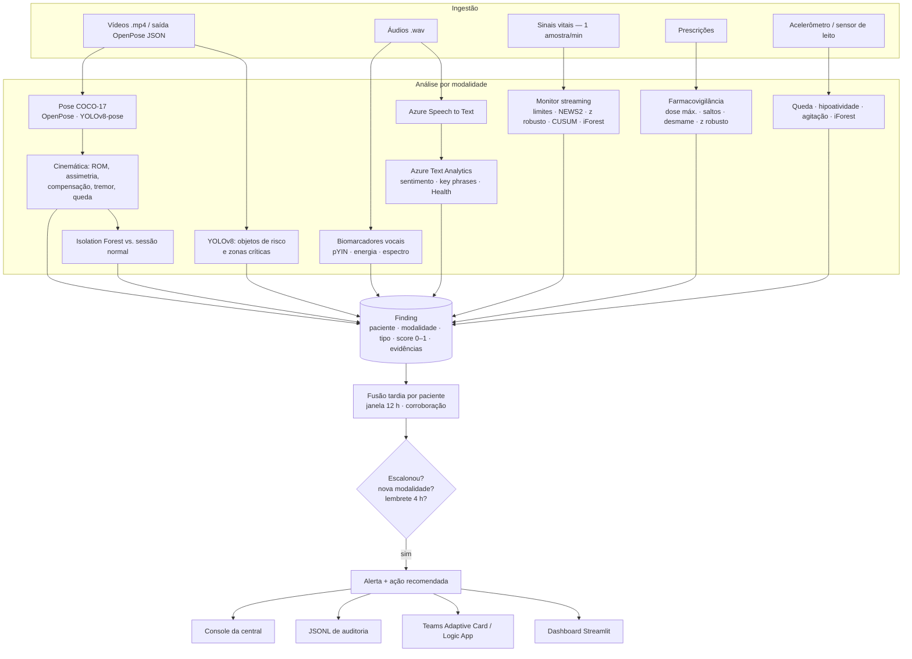
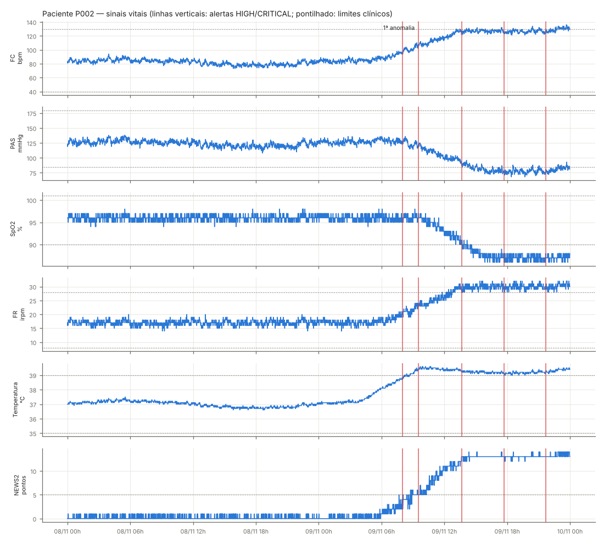
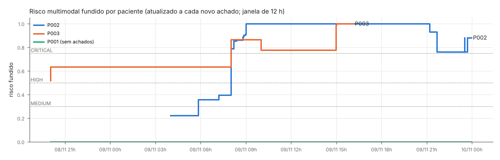
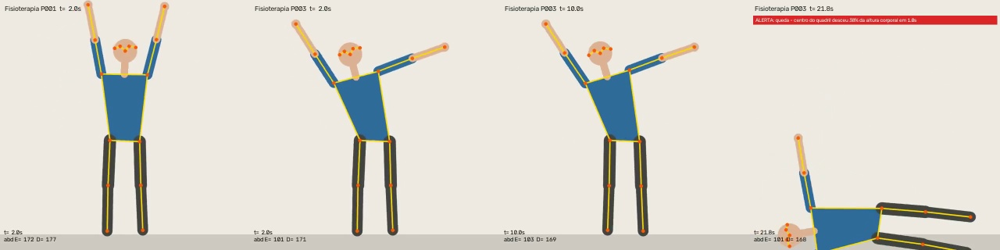
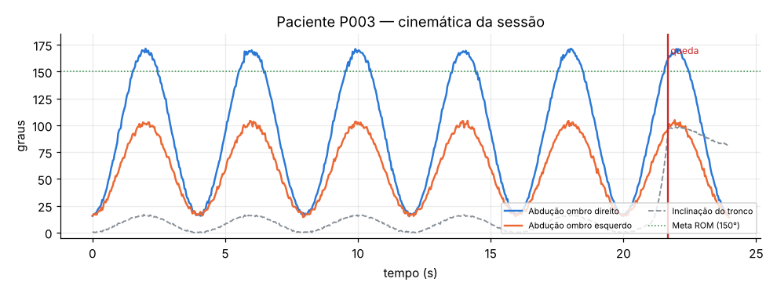
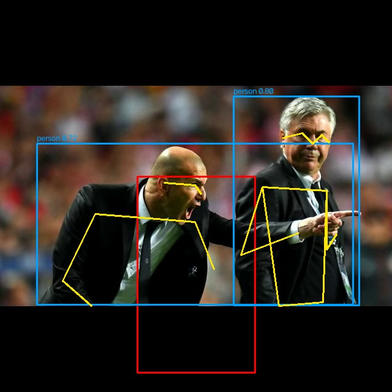
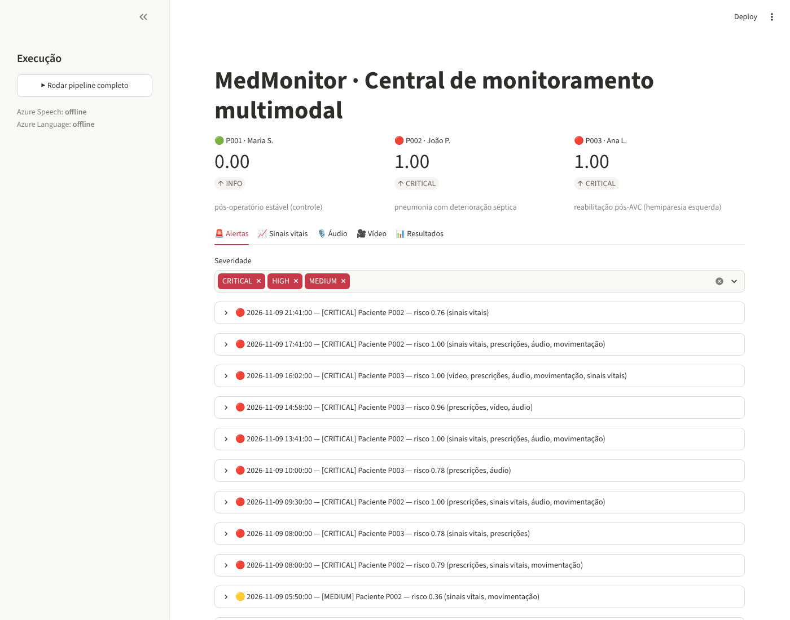

# Relatório Técnico — MedMonitor

**Tech Challenge · Fase 4 · IA para Devs (POSTECH)**
Monitoramento contínuo de pacientes com dados multimodais (vídeo, áudio, texto e sinais clínicos) e
detecção de anomalias em tempo real, integrado ao Azure AI.

---

## 1. Problema e objetivo

O hospital já usa IA para analisar exames e documentos. O próximo passo é **monitorar continuamente** o
paciente e identificar **sinais precoces de risco** cruzando fontes que hoje são analisadas isoladamente:

| Fonte | Pergunta clínica |
|---|---|
| Vídeo de fisioterapia/cirurgia/leito | O movimento ou o procedimento desviou do padrão esperado? Houve queda? |
| Áudio de consultas | A voz mostra fadiga, dispneia ou disartria? O paciente relatou sintomas críticos? |
| Sinais vitais (stream) | Há deterioração aguda ou tendência silenciosa (ex.: sepse)? |
| Prescrições | Houve alteração inesperada do tratamento (erro de dose, suspensão abrupta)? |
| Movimentação no leito | Queda, letargia, agitação noturna (delirium)? |

O objetivo é **fundir** essas evidências em um único risco por paciente e entregar à equipe **poucos
alertas, priorizados e acionáveis**, evitando a fadiga de alarmes.

## 2. Arquitetura e fluxo multimodal



### 2.1 Contrato comum: `Finding`

Todos os analisadores devolvem objetos `Finding` (`medmonitor/schemas.py`) com o mesmo formato:
`patient_id`, `modality`, `kind` (ex.: `spo2_low`, `voice_disartria`, `fall_detected`), `score` 0–1,
`description` legível, `timestamp`, `evidence` (valores que justificam o achado) e `source` (modelo ou
técnica). Esse contrato é o que torna a fusão independente da modalidade e permite incluir novas fontes
sem alterar o restante do sistema. O score é mapeado em severidade: ≥ 0,75 CRITICAL, ≥ 0,5 HIGH,
≥ 0,3 MEDIUM.

### 2.2 Tempo real

O monitor de sinais vitais (`StreamingVitalsMonitor.update`) processa **uma amostra por vez**, com estado
por paciente (janelas deslizantes, acumuladores CUSUM, contadores de persistência e cooldown). O pipeline
reproduz os 48 h de dados em ordem cronológica, intercalando os achados de áudio/vídeo no instante de cada
sessão (`data/sessions.json`), exatamente como aconteceria em produção. O comando
`python -m medmonitor.cli stream --speed 3600` mostra os alertas surgindo enquanto os dados "chegam".
Custo: ~2 ms por amostra em CPU (Python puro), suficiente para centenas de leitos a 1 amostra/min por instância.

## 3. Modelos e técnicas por tipo de dado

### 3.1 Vídeo

| Etapa | Modelo / técnica | Arquivo |
|---|---|---|
| Estimação de pose | **OpenPose** (leitura da saída `--write_json` BODY_25/COCO-18, ou execução do modelo Caffe via `cv2.dnn`) e **YOLOv8n-pose** (Ultralytics) — todos normalizados para o esqueleto COCO-17 | `video/pose.py` |
| Objetos e áreas críticas | **YOLOv8n** (COCO-80): instrumentos cortantes (`knife`, `scissors`), pessoas em zonas poligonais configuráveis (ex.: campo estéril), contagem de instrumentos início × fim | `video/detector.py` |
| Biomecânica | ângulo de abdução do ombro (braço × tronco), ROM por repetição (`find_peaks`), assimetria entre lados, inclinação lateral do tronco (compensação) | `video/movement.py` |
| Tremor | filtro Butterworth passa-banda 3–7 Hz na trajetória do punho; índice = RMS / comprimento do tronco; frequência dominante via FFT | `video/movement.py` |
| Queda | descida do centro do quadril > 35 % da altura corporal em 1 s **e** tronco > 45° da vertical | `video/movement.py` |
| Padrão anômalo | **Isolation Forest** treinado nos quadros de uma sessão normal de referência (ângulos, assimetria, inclinação e velocidades) | `video/movement.py` |
| Relatório | vídeo anotado (esqueleto + faixa de alerta), gráfico de ângulos, relatório Markdown e JSON de métricas | `video/report.py` |

A análise é **independente do backend de pose**: trocar OpenPose por YOLOv8-pose (ou MediaPipe) muda só a
etapa de extração.

### 3.2 Áudio

| Etapa | Modelo / técnica | Arquivo |
|---|---|---|
| Transcrição | **Azure Speech to Text** (pt-BR, reconhecimento contínuo, saída detalhada com confiança). Fallback: faster-whisper local ou transcrição de referência | `audio/azure_speech.py` |
| Texto | **Azure Text Analytics**: sentimento com *opinion mining*, frases-chave, **Text Analytics for Health** (sintomas, estruturas corporais, medicações, negação). Fallback: léxico clínico em português | `audio/azure_text.py` |
| Termos críticos | lista configurável (falta de ar, dor no peito, fala enrolada, confusão…) com normalização de acentos | `config/settings.yaml` |
| Biomarcadores vocais | F0 por **pYIN**; detecção de fala por energia + vozeamento; taxa de fala (núcleos silábicos), razão de pausas; **jitter** e **shimmer** (perturbação de curto prazo vs. tendência local); **HNR** por autocorrelação; energia > 2,5 kHz (nitidez articulatória); eventos de respiração audível nos silêncios | `audio/features.py` |

Os marcadores são agrupados em **fadiga** (fala lenta, pausas), **disartria** (jitter, shimmer, HNR,
articulação) e **respiratório** (respiração audível). Um grupo só gera achado quando ≥ 50 % dos seus
marcadores concordam, o que reduz falsos positivos por um único parâmetro ruidoso.

### 3.3 Sinais vitais (tempo real)

Cinco camadas complementares, todas com **persistência** (3 amostras consecutivas) e **cooldown**
(30 min por tipo de achado):

1. **Limites clínicos** absolutos (FC, PAS, SpO2, FR, temperatura).
2. **NEWS2** (National Early Warning Score 2) — padrão clínico para deterioração; ≥ 5 urgente, ≥ 7 emergência.
3. **Z-score robusto** (mediana/MAD em janela de 60 min) — mudanças abruptas.
4. **CUSUM** sobre o desvio em relação à linha de base do paciente (primeiras 6 h), com desvio-padrão
   mínimo clínico para não confundir ritmo circadiano com anomalia — detecta **tendências lentas** antes
   que os limites sejam cruzados. Só tendências clinicamente adversas são reportadas.
5. **Isolation Forest** multivariado treinado na linha de base do próprio paciente — combinações atípicas.

### 3.4 Prescrições

Regras de farmacovigilância (`anomaly/prescriptions.py`): dose diária acima do máximo de referência
(peso maior para **medicamentos de alta vigilância**), salto de dose > 2× entre prescrições consecutivas
(com marcação de **possível erro de casa decimal** para razões ≈ 10×), **suspensão abrupta** de fármacos
que exigem desmame (betabloqueadores, clonidina, corticoides, benzodiazepínicos) e dose atípica frente à
distribuição hospitalar (z-score robusto do log da dose).

### 3.5 Movimentação durante a internação

`anomaly/mobility.py`: **queda suspeita** (pico de aceleração + imobilidade fora do leito ≥ 10 min),
**hipoatividade** (atividade diurna < 50 % da linha de base, janela de 4 h), **agitação noturna**
(≥ 3 saídas do leito à noite em 4 h) e **Isolation Forest** sobre features horárias (média, variabilidade,
minutos fora do leito, hora do dia).

### 3.6 Fusão multimodal e alertas

Fusão **tardia** (`fusion.py`), por paciente, numa janela de 12 h:

```
m_mod = min(1, max(score da modalidade) + 0,05 × (tipos distintos − 1))
risco = 0,6 × max(m_mod) + 0,4 × Σ w_mod · m_mod + 0,10 × (nº de modalidades com m ≥ 0,5 − 1)
pesos: vitais 0,40 · áudio 0,20 · vídeo 0,15 · prescrições 0,15 · mobilidade 0,10
```

- O termo `max` garante que **um evento grave isolado** (ex.: queda) nunca seja diluído pela média.
- A média ponderada e o **bônus de corroboração** elevam o risco quando fontes independentes concordam
  (ex.: SpO2 em queda + relato de falta de ar + respiração audível).
- Um alerta é emitido quando o nível **escala**, quando surge **evidência de nova modalidade** (após 1 h
  de cooldown) ou como **lembrete** a cada 4 h enquanto o risco persistir.
- Cada alerta traz as principais evidências e uma **ação recomendada** derivada dos tipos de achado
  (protocolo de sepse, revisão de prescrição com farmácia clínica, protocolo pós-queda, NIHSS/protocolo AVC,
  rastreio de delirium etc.).
- Canais: console da central, **JSONL de auditoria**, **Adaptive Card no Microsoft Teams** (HIGH/CRITICAL)
  e dashboard Streamlit.

## 4. Dados

Os conjuntos públicos sugeridos (PhysioNet, AudioSet) não trazem, para o mesmo paciente, vídeo + voz +
sinais vitais + prescrições, nem rótulos das anomalias que o desafio pede. Por isso a avaliação usa um
**conjunto sintético com ground truth conhecido** (`medmonitor/synthetic/`, regenerável com
`scripts/generate_data.py`), e o código aceita dados reais sem alteração:

| Modalidade | Dados de demonstração | Dados reais suportados |
|---|---|---|
| Sinais vitais | 3 pacientes × 48 h × 1/min, com ritmo circadiano e ruído AR(1) | `scripts/download_physionet.py` (BIDMC/PhysioNet, HR/SpO2/FR a 1 Hz) |
| Vídeo | sessões de abdução de ombro: keypoints no formato OpenPose BODY_25 + vídeo renderizado; clipe com fotos reais para o YOLOv8 | qualquer `.mp4` (YOLOv8-pose) ou saída do OpenPose |
| Áudio | voz pt-BR (`espeak-ng`) com degradações controladas: fadiga/dispneia (fala lenta, pausas, inspirações) e disartria (jitter, shimmer, soprosidade, passa-baixa) | qualquer `.wav` |
| Prescrições / mobilidade | eventos injetados (erro decimal, suspensão abrupta, queda, agitação) | CSV no mesmo formato |

| Paciente | Perfil | Anomalias injetadas |
|---|---|---|
| P001 | pós-operatório estável (**controle**) | apenas um artefato de 1 amostra de SpO2 = 72 % (**não** deve alertar) |
| P002 | pneumonia com deterioração séptica | febre a partir de 28 h, taquicardia/taquipneia, hipotensão, dessaturação; enoxaparina 40 → 400 mg; morfina 2,5×; voz com dispneia; letargia e agitação noturna |
| P003 | reabilitação pós-AVC | crise hipertensiva (40 min) e bradicardia (15 min); fisioterapia com ROM esquerda reduzida, compensação de tronco, tremor de 5 Hz e queda; disartria; insulina acima do limite; metoprolol suspenso |

## 5. Resultados

Execução completa (`python -m medmonitor.cli run-all`) em CPU de 2 núcleos: **~45 s**
(áudio 3 s · vídeo 22 s, incluindo YOLOv8 e geração dos vídeos anotados · 8 640 amostras de sinais vitais
+ prescrições + mobilidade 19 s).

### 5.1 Acerto contra o ground truth — 16/16

| Paciente | Modalidade | Evento | Esperado | Detectado | Latência |
|---|---|---|---|---|---|
| P001 | vitais | artefato isolado de SpO2 | não alertar | não alertou ✔ | — |
| P002 | vitais | deterioração séptica | alertar | ✔ | 110 min após o início da febre (CUSUM) |
| P003 | vitais | crise hipertensiva | alertar | ✔ | 2 min |
| P003 | vitais | bradicardia | alertar | ✔ | 2 min |
| P002 | prescrições | enoxaparina 10× | alertar | ✔ (erro decimal) | imediato |
| P002 | prescrições | morfina 2,5× | alertar | ✔ | imediato |
| P003 | prescrições | insulina acima do limite | alertar | ✔ | imediato |
| P003 | prescrições | suspensão abrupta de metoprolol | alertar | ✔ | imediato |
| P002 | mobilidade | hipoatividade/letargia | alertar | ✔ | 2 h (janela de 4 h) |
| P002 | mobilidade | agitação noturna | alertar | ✔ | 31 min |
| P003 | mobilidade | queda | alertar | ✔ | 0 min |
| P001 | vídeo | sessão normal | não alertar | não alertou ✔ | — |
| P003 | vídeo | ROM ↓, assimetria, compensação, tremor, queda | alertar | ✔ (6 achados) | — |
| P001 | áudio | fala normal | não alertar | não alertou ✔ | — |
| P002 | áudio | fadiga + dispneia + termos críticos | alertar | ✔ | — |
| P003 | áudio | disartria + termos críticos | alertar | ✔ | — |

**Detecção antecipada.** Para P002, a primeira detecção veio do **CUSUM às 05:50** (tendência febril),
seguida do Isolation Forest às 07:11; os **limites clínicos só foram cruzados às 08:48** e o NEWS2 ≥ 5 às
08:52 — **~3 h de antecedência** em relação a um monitor baseado só em limiares.

**Redução de alarmes.** Os ~344 achados brutos viraram **11 alertas consolidados**; o paciente estável
(P001) não recebeu nenhum.




### 5.2 Vídeo — fisioterapia

| Métrica | P001 (normal) | P003 (pós-AVC) | Referência |
|---|---|---|---|
| Repetições | 6 | 5 (+ queda) | — |
| ROM ombro esquerdo | 175° | **104°** | ≥ 150° |
| ROM ombro direito | 176° | 171° | ≥ 150° |
| Assimetria | 1° | **67°** | ≤ 20° |
| Inclinação de tronco (p95) | 2° | **16°** | ≤ 12° |
| Tremor punho esquerdo | 0,5 % | **3,0 % a 5,0 Hz** | ≤ 1,5 % |
| Quadros fora do padrão (iForest) | 1,1 % | **23,9 %** | — |
| Queda | — | **t = 21,7 s** | — |




Relatório automático gerado: `outputs/video/video_P003_relatorio.md` (métricas, desvios por severidade e
linha do tempo). Exemplo de desvios reportados:

- `CRITICAL` Queda detectada durante a sessão em t=21,7 s
- `HIGH` Amplitude de abdução do ombro esquerdo reduzida: 104° (meta ≥ 150°)
- `HIGH` Assimetria entre membros de 67° (limite 20°)
- `HIGH` Tremor no membro superior esquerdo (~5,0 Hz, índice 3,0 %)
- `HIGH` Compensação de tronco: inclinação lateral de 16° (limite 12°)
- `MEDIUM` 24 % dos quadros fora do padrão da sessão de referência

**YOLOv8 em pixels reais.** No clipe com fotografias reais, o YOLOv8n detectou pessoas (conf. ≈ 0,8),
gravata e ônibus, e o YOLOv8n-pose estimou em média 2,7 esqueletos por quadro; a presença de pessoa dentro
da zona crítica configurada ("campo estéril") gerou o achado `critical_zone_intrusion`.



### 5.3 Áudio

| Marcador | P001 | P002 | P003 | Limiar |
|---|---|---|---|---|
| Taxa de fala (síl./s) | 4,5 | **2,6** | **2,9** | ≥ 3,2 |
| Razão de pausas | 0,17 | **0,28** | **0,29** | ≤ 0,25 |
| Respiração audível (/min) | 0 | **9,0** | 3,0 | ≤ 6 |
| Jitter (%) | 0,35 | 0,29 | **0,50** | ≤ 0,45 |
| Shimmer (%) | 13,2 | 10,8 | **22,3** | ≤ 18 |
| HNR (dB) | 3,4 | 3,8 | **0,7** | ≥ 2,0 |
| Sentimento | positivo | negativo | negativo | — |
| Termos críticos | — | falta de ar, dor no peito, tontura, cansaço | confusão, fala enrolada, formigamento | — |
| Achados | nenhum | fadiga (HIGH), respiratório (CRITICAL), termos (CRITICAL) | fadiga (HIGH), **disartria (CRITICAL)**, termos (CRITICAL) | — |

Os marcadores separam os perfis: P002 se destaca pela **respiração audível e pausas** (dispneia/fadiga)
sem alteração fonatória; P003 pela **instabilidade fonatória** (jitter, shimmer, HNR) típica da disartria.

### 5.4 Exemplo de alerta enviado à equipe

```
CRITICAL  2026-11-09 09:30  Paciente P002 — risco 1.00 (prescrições, sinais vitais, áudio, movimentação)
  ↳ enoxaparina: dose diária 400 mg acima do máximo de referência (200 mg/dia) — MEDICAMENTO DE ALTA
    VIGILÂNCIA; morfina: dose mudou 2.5× em relação à prescrição anterior (24 → 60 mg/dia);
    NEWS2 = 5 (risco médio — avaliação urgente); Sinais vocais de fadiga (fala lentificada / pausas longas)
  ↳ AÇÃO: Acionar Time de Resposta Rápida imediatamente. Suspeita de deterioração clínica/sepse: avaliar à
    beira-leito, colher lactato e hemoculturas e considerar protocolo de sepse (antibiótico na 1ª hora).
    Possível erro de prescrição em medicamento de alta vigilância: SUSPENDER administração e revisar com
    farmácia clínica e prescritor. Alteração de comportamento motor: rastrear delirium (CAM-ICU).
```



## 6. Limitações e próximos passos

- **Dados sintéticos.** Comprovam o fluxo e a lógica de detecção com ground truth, mas não substituem
  validação clínica. Próximo passo: MIMIC-IV/eICU (sinais vitais + prescrições reais) e bases de voz
  patológica (ex.: TORGO, Saarbrücken) para recalibrar limiares e medir sensibilidade/especificidade.
- **Limiares vocais** foram calibrados numa voz sintetizada; em produção devem ser ajustados por
  **linha de base do próprio paciente** (o desvio em relação a ele mesmo é mais informativo que um corte populacional).
- **Jitter/shimmer** são aproximados por quadro (10 ms), não por ciclo glotal como no Praat.
- **Vídeo cirúrgico**: o YOLOv8 pré-treinado em COCO só reconhece objetos genéricos (tesoura, faca); para
  instrumentais específicos é preciso *fine-tuning* com datasets como Cholec80/m2cai16-tool.
- **Fusão** com pesos definidos por especialista; com histórico de desfechos, pode ser aprendida
  (regressão logística/gradient boosting) e calibrada.
- **Privacidade e regulação**: em produção, processamento em região Brasil, criptografia, controle de
  acesso, anonimização de mídia e conformidade com LGPD; o sistema é de **apoio** à decisão, não substitui
  a avaliação médica.
