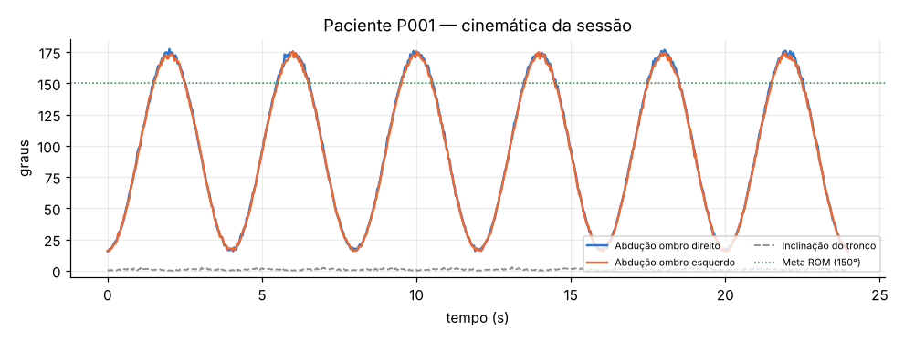

# Relatório automático de vídeo — paciente P001

- Duração analisada: **24.0 s** (720 quadros)
- Backend de pose: **openpose-json**

## Métricas

| Métrica | Valor |
|---|---|
| repeticoes | 6 |
| rom_esquerdo_graus | 174.7 |
| rom_direito_graus | 175.9 |
| assimetria_graus | 1.2 |
| inclinacao_tronco_p95_graus | 1.9 |
| tremor_esq_indice | 0.48 |
| tremor_esq_freq_hz | 5.4 |
| tremor_dir_indice | 0.49 |
| queda_t_s | None |
| frames_validos_pct | 100.0 |
| frames_fora_do_padrao_pct | 1.1 |

## Desvios / falhas detectados

Nenhum desvio relevante — sessão dentro do padrão esperado.

## Linha do tempo de eventos

- (sem eventos)

