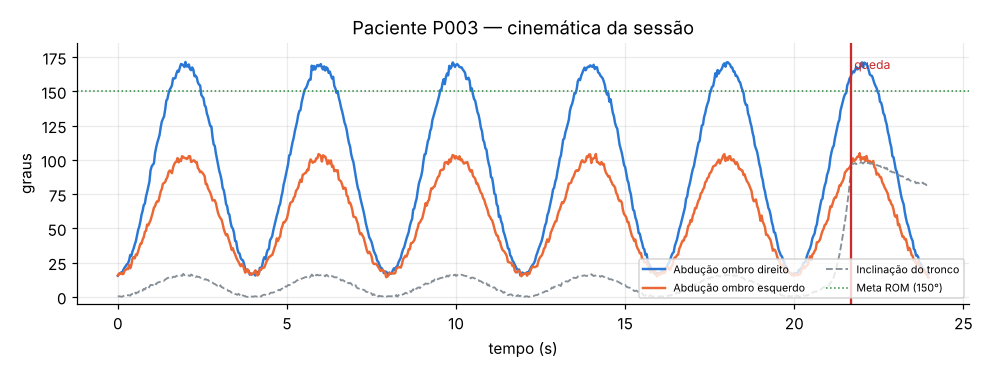

# Relatório automático de vídeo — paciente P003

- Duração analisada: **24.0 s** (720 quadros)
- Backend de pose: **openpose-json**

## Métricas

| Métrica | Valor |
|---|---|
| repeticoes | 5 |
| rom_esquerdo_graus | 104.2 |
| rom_direito_graus | 171.1 |
| assimetria_graus | 66.9 |
| inclinacao_tronco_p95_graus | 15.8 |
| tremor_esq_indice | 3.0 |
| tremor_esq_freq_hz | 5.0 |
| tremor_dir_indice | 0.49 |
| queda_t_s | 21.67 |
| frames_validos_pct | 100.0 |
| frames_fora_do_padrao_pct | 23.9 |

## Desvios / falhas detectados

| Severidade | Achado | Fonte |
|---|---|---|
| CRITICAL | Queda detectada durante a sessão em t=21.7s | pose keypoints + regra cinemática |
| HIGH | Assimetria entre membros de 67° (limite 20°) | pose keypoints |
| HIGH | Amplitude de abdução do ombro esquerdo reduzida: 104° (meta ≥150°) | pose keypoints |
| HIGH | Tremor no membro superior esquerdo (~5.0 Hz, índice 3.0%) | pose keypoints + filtro passa-banda 3–7 Hz |
| HIGH | Compensação de tronco: inclinação lateral de 16° (limite 12°) | pose keypoints |
| MEDIUM | 24% dos frames fora do padrão da sessão de referência | Isolation Forest (referência normal) |

## Linha do tempo de eventos

- **21.7s** — queda: centro do quadril desceu 38% da altura corporal em 1.0s

